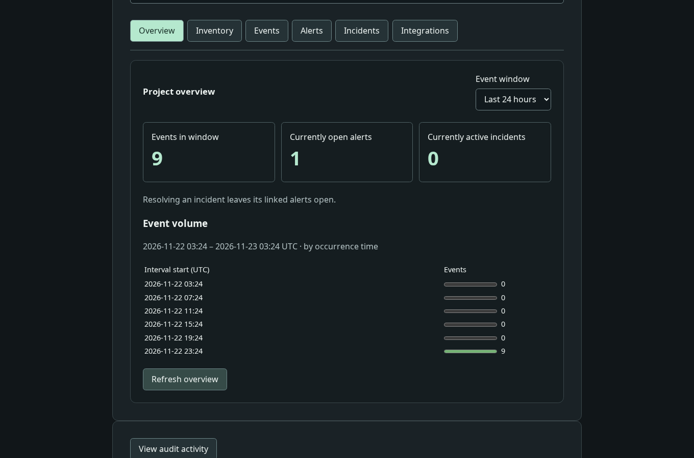
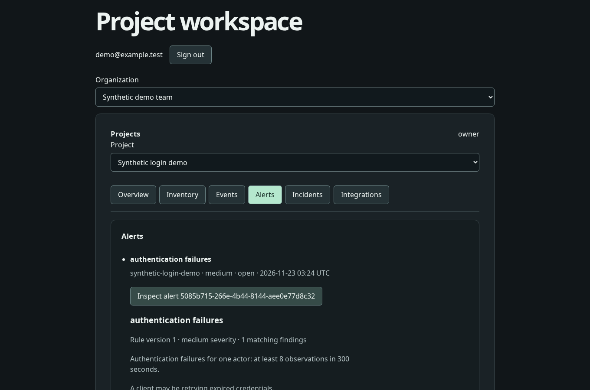
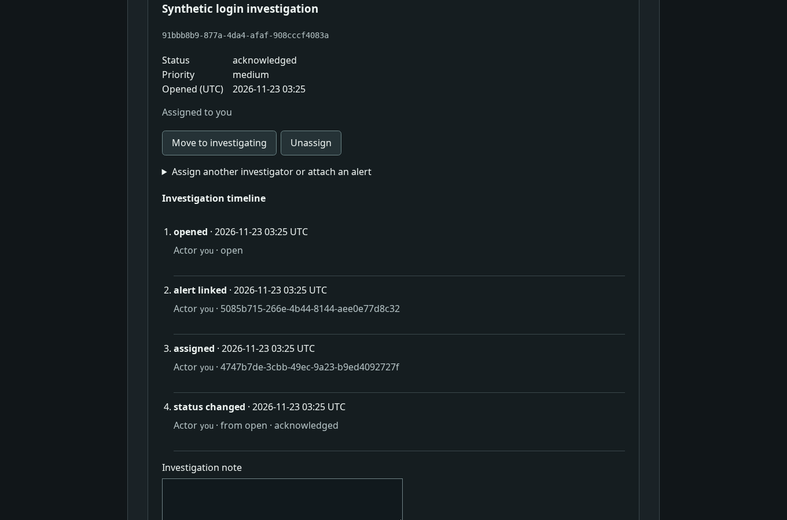

# API Sentinel

API Sentinel helps a team investigate unusual traffic reported by its own APIs. Import an OpenAPI contract, send events from an instrumented application, then trace a rule-generated alert back to its supporting observations. Investigators can assign an incident, add notes and record its resolution.

[Watch the demo (MP4)](docs/media/demo.mp4) · [Follow the same synthetic investigation](docs/local-demo.md)



## Run the demo locally

Use Git, Docker Compose v2.20+ and Python 3.11+. On Windows, start Docker Desktop in Linux container mode. The first build downloads dependencies. The demo runs locally without a paid service.

```sh
git clone https://github.com/risbh19/api-sentinel.git
cd api-sentinel
python scripts/init_env.py
docker compose up --build --wait
python scripts/smoke.py
docker compose run --rm migrate python -m api_sentinel.identity.operator create-user demo-owner@example.test --demo
```

Choose a password at the prompt. Open the [workspace](http://127.0.0.1:8080/#workspace), sign in and select **Synthetic login demo**.

1. In **Inventory**, import [login-demo.yaml](examples/login-demo.yaml).
2. In **Integrations**, create an ingestion key. Run `python scripts/emit_event.py --demo` and paste the key at the hidden prompt. The first submission stores nine events. Replaying the same batch reports nine duplicates.
3. In **Alerts**, inspect the authentication failures alert. The default rule links eight failures for one actor within five minutes. Choose **Create incident from alert** to begin investigating.

Stop the stack with `docker compose down`. Keep the generated `.env` with its database volume for the next session.

## Inside an investigation

[See the imported routes](docs/media/inventory.png) · [See the accepted events](docs/media/events.png)



The worker evaluates three configurable patterns: repeated authentication failures, repeated authorization denials and high request volume. Each finding records the rule version, threshold, window and supporting event IDs. Reported patterns can have benign explanations.



## Architecture and data

FastAPI serves the API, PostgreSQL stores project records and durable jobs, and a separate worker processes queued events. React and TypeScript power the workspace. The packaged web and API ports bind to loopback. Sessions and organization roles govern project access. Actor and client labels are pseudonymized per project. Emitters must omit credentials, personal data, bodies and query strings.

## Development and operations

| Task | Reference |
| --- | --- |
| Run tests and build the frontend | Install uv 0.13.9 and Node 24.22.3, then run `python scripts/check.py`. [Development setup](docs/local-reference.md#develop-and-test) |
| Understand storage, permissions and privacy limits | [Architecture](docs/architecture.md) · [Threat model](docs/threat-model.md) · [Event contract](docs/event-ingestion.md) |
| Tune thresholds or manage an investigation | [Detection rules](docs/detection-rules.md) · [Incident workflows](docs/incident-workflows.md) |
| Check migrations, retention or recovery | [Operator reference](docs/local-reference.md) · [Operations runbook](docs/operations.md) |
| Verify a release candidate | [Release evidence and Windows walkthrough](docs/release-readiness.md) · [Security checks](docs/security-checks.md) |
