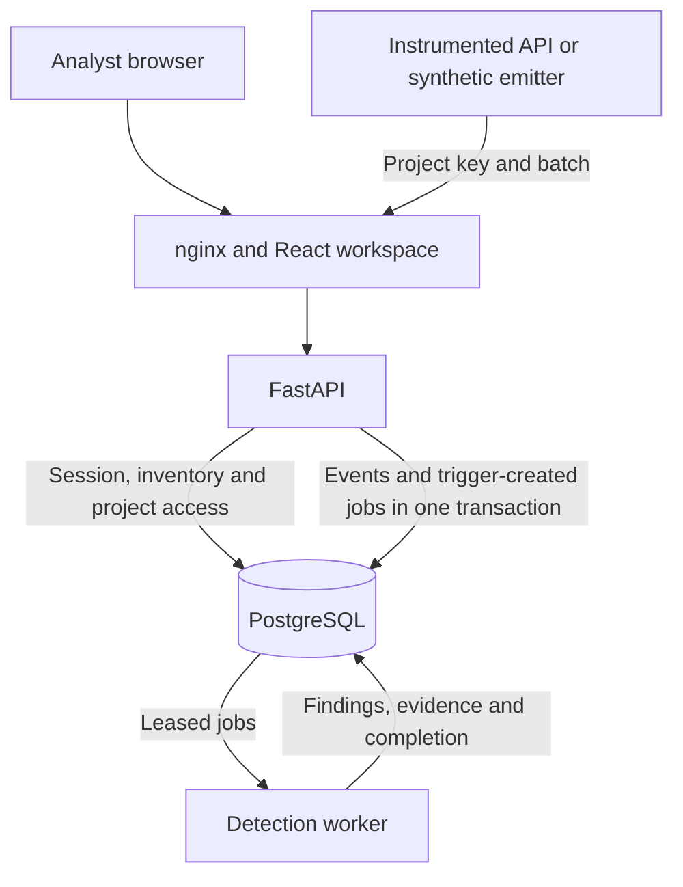

# Architecture

API Sentinel packages one FastAPI application and a separately running detection worker built from the same Python image. PostgreSQL 16 stores the organization and project boundaries, telemetry and investigation records. The browser reads live project APIs through the same-origin nginx proxy.

| Operation | Code and data boundary |
| --- | --- |
| Sign in and select a project | `identity` validates sessions and resolves organization membership on each request. Project roles derive from that membership. |
| Import a contract | `inventory` parses bounded local OpenAPI files and persists versioned operations. An import describes declared endpoints. |
| Accept a batch | `ingestion` authenticates a project key, validates typed fields, pseudonymizes actor and client tokens and deduplicates deliveries. A PostgreSQL trigger creates a job for each accepted event before commit. |
| Evaluate a rule | The worker leases jobs, evaluates project/source-scoped event-time windows and commits findings with job completion. Unique constraints and fenced attempts protect replay. |
| Investigate | The dashboard reads project totals, alerts and surviving evidence. Authorized actions update versioned incidents and append timeline and audit entries. |
| Operate | Compose bootstrap applies Alembic migrations and grants. The readiness probe, API runtime and worker use separate database roles. Backup, restore and expiry commands run from the operator environment. |

The data model and failure semantics for each path are documented alongside the implementation. [Event ingestion](event-ingestion.md) · [Detection rules](detection-rules.md) · [Incident workflows](incident-workflows.md) · [Operations](operations.md)
