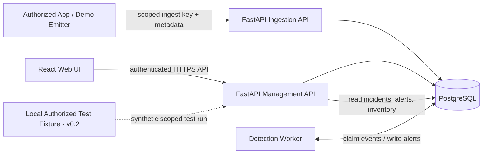

# API Sentinel — Master Product & Engineering Build Plan

**Project:** `api-sentinel`
**Proposed repository:** `https://github.com/risbh19/api-sentinel` (verify ownership, existence, visibility, and access before writing)
**Document version:** 1.0
**Prepared:** 19 November 2026
**Primary execution environment:** ChatGPT Work **or** Codex
**Project type:** Open-source, software-only API security monitoring and developer-focused incident response platform
**Status:** Planning specification. **Nothing in this plan implies the code, repository, tests, or deployment already exists.**

> **Executive instruction:** Use this document as the project's source of planning truth. Inspect the actual repository before touching code; reconcile differences by documenting the decision, not by blindly overwriting existing work. Deliver working, tested vertical slices via small GitHub pull requests. Separate *observed security signals* from *proven vulnerabilities*. Never test systems without authorization.

---

## 0. How to use this plan with ChatGPT Work or Codex

This is an **execution plan**, not merely a list of features. The agent must turn it into issues, changes, tests, reviewable PRs, and verified merges. It must adapt to the tools and permissions actually available.

### Mode A — ChatGPT Work

1. Open **Work** and give it this `.md` file and the GitHub repository URL.
2. Connect GitHub if needed and explicitly authorize relevant repository operations.
3. Paste the **Kickoff Prompt** in section 23.
4. Have Work inspect the repository and produce an evidence-based baseline, then create an initial Phase 0 PR.
5. Work should report real URLs, branch names, checks, and merge SHAs, not simulated outcomes.

### Mode B — Codex

1. Open the `api-sentinel` repository as a workspace in Codex, using the existing directory or a fresh clone.
2. Place this file in `docs/planning/MASTER_BUILD_PLAN.md` on a feature branch; preserve a copy outside the repo until its first PR is reviewed.
3. Paste the **Kickoff Prompt** in section 23.
4. Let Codex inspect the codebase and use its available terminal/GitHub capabilities to implement one PR at a time.
5. Review the diff and validation results before every merge.

**Use only one primary code-writing agent on a branch at a time.** An independent second model may review the diff and recommend fixes, but should not silently change the same working tree.

### Non-negotiable boundaries

- No direct commits or pushes to `main` after initial repository creation.
- No fabricated tests, audit claims, coverage, benchmarks, screenshots, or PR links.
- No automated active scanning of third-party targets. Explicit scoped authorization is mandatory.
- No secrets in source, examples, logs, PRs, screenshots, or CI artifacts.
- No public deployment with development credentials or vulnerable demo endpoints enabled.
- No irreversible actions (history rewriting, destructive migration, credential rotation, public exposure) without appropriate approval and an operational plan.
- No merge while required checks are failing or required reviews are outstanding.

---

## 1. Product brief and real-world problem

### 1.1 Problem statement

Many software teams build and operate APIs without a unified view of their exposed routes, authentication failures, suspicious usage patterns, or investigation history. Traditional vulnerability scanners and runtime monitoring systems solve different parts of this problem; smaller teams may lack a clear, affordable workflow connecting API inventory, telemetry, explainable detections, and response.

**API Sentinel** is an open-source, developer-focused security platform that helps teams:

1. Maintain a trustworthy inventory of their own APIs.
2. Send **minimal, structured security event metadata** from an explicitly integrated application.
3. Apply explainable detection rules to identify suspicious **behavior**.
4. Correlate alerts, triage incidents, investigate evidence, and document resolutions.
5. Later, perform carefully scoped authorization tests against **owned/authorized test fixtures** and integrate CI security checks.

It is **not** a WAF, reverse proxy, full SIEM, EDR, vulnerability oracle, or attack-prevention product in the first release.

### 1.2 Target users

- Backend engineers maintaining REST APIs.
- Application security and DevSecOps engineers.
- Small-team security responders.
- Open-source maintainers who want reproducible API security workflows.

### 1.3 Core jobs to be done

- *As an owner,* import an OpenAPI file and know what endpoints my API exposes.
- *As an engineer,* send security events without leaking tokens or request bodies.
- *As a responder,* identify repeated auth failures and see the rule/evidence behind an alert.
- *As an investigator,* assign, comment on, resolve, and reopen an incident with an audit trail.
- *As an administrator,* safely manage project access, ingestion keys, and data retention.
- *As a contributor,* clone, test, and demonstrate the system locally with no paid services.

### 1.4 Product principles

- **Evidence before assertion:** do not claim BOLA or exploitation from a log pattern alone.
- **Privacy by default:** avoid raw bodies, raw authorization headers, and full URLs containing sensitive values.
- **Explainability:** each alert shows rule identifier/version, inputs, threshold/window, and supporting event references.
- **Least privilege and tenant isolation:** all records are scoped to an organization/project.
- **Determinism first:** reproducible rules before ML or generative AI.
- **Incremental delivery:** a usable end-to-end feature beats an empty UI for ten modules.
- **No-cost local development:** local Docker infrastructure and open-source dependencies.

---

## 2. Scope and release strategy

### 2.1 MVP v0.1 — required

The smallest useful, defensible system:

1. Monorepo with a backend, frontend, PostgreSQL, Docker Compose, reproducible setup, and passing CI.
2. Local-first account authentication, basic organization/project isolation, and RBAC.
3. OpenAPI 3.x **file upload/import** (local files only for MVP), normalized API inventory, import errors, and safe parser boundaries.
4. Authenticated project ingestion keys and `POST /v1/ingest/events` with fixed metadata schema.
5. At-least-once-safe event persistence with idempotent deduplication and backpressure behavior.
6. Two or three explainable rule types: repeated auth failures, repeated authorization denials, and abnormal request volume per pseudonymous actor/route.
7. Alerts and incidents with acknowledge, assign, resolve, reopen, evidence, and history.
8. Functional web dashboard, endpoint inventory, event explorer, and incident details; all backed by real API responses.
9. Synthetic sample emitter and seed data clearly marked **demo** for a reproducible walkthrough.
10. Automated tests, security checks, privacy defaults, operational docs, and a release checklist.

### 2.2 Follow-up v0.2 — not a blocker for MVP

- Explicitly scoped BOLA/BFLA authorization regression harness against local owned fixtures.
- Rules configuration UI and tuning with false-positive review.
- Import-history diff and endpoint changes.
- Rule replay on test datasets.
- Exportable incident reports.
- Security testing integration in CI; optional OWASP ZAP passive/authorized checks.
- GitHub Actions artifact/report integration where permissions allow.

### 2.3 Later v0.3+ — only after evidence

- Additional SDKs/integrations for supported frameworks/gateways.
- Advanced correlation and anomaly analytics after a labeled evaluation dataset exists.
- Multi-org administration and optional SSO.
- Advanced retention/archiving, event streaming, and worker scaling.
- Alert webhooks and external issue/ticket creation.
- Production deployment reference architecture with backup/restore drills.

### 2.4 Explicitly out of scope for v0.1

- Automated offensive exploitation, arbitrary public scanning, or attack traffic generation.
- Transparent packet capture, TLS interception, or traffic sniffing.
- Arbitrary customer API proxying or blocking in the data path.
- Claims of real-time prevention or accurate vulnerability confirmation from telemetry alone.
- LLM-powered scoring as the source of truth.
- Kafka, Kubernetes, multiple microservices, paid services, or unnecessary third-party analytics.
- A mobile app, IoT features, enterprise billing, or marketplace.

### 2.5 Suggested milestone gates

| Milestone | Required demonstrable outcome | Dependency |
|---|---|---|
| M0 Foundation | Clone → setup → test → CI on PR | None |
| M1 Secure workspace | Sign in and create org/project with isolation tests | M0 |
| M2 Inventory | Import a spec and browse routes | M1 |
| M3 Ingestion | Synthetic app sends deduplicated events to project | M1 |
| M4 Detection | Known fixture produces deterministic alert/evidence | M3 |
| M5 Incidents | Triage alert into incident with audit trail | M4 |
| M6 Dashboard | Full end-to-end journey, no fake metrics | M2–M5 |
| M7 Hardening/release | All gates pass and MVP documented | M0–M6 |
| M8 Authorized testing (v0.2) | Fixture-based BOLA/BFLA checks with scope controls | M7 |

Do **not** promise dates until actual repository complexity, available machine resources, and working schedule are assessed.

---

## 3. Reference standards and boundaries

Use these as references, **not** as blanket compliance claims:

- [OWASP API Security Top 10 (2023)](https://api-security.owasp.org/editions/2023/en/0x11-t10/) — domain risk taxonomy, including broken object-level authorization, authentication, function-level authorization, resource consumption, inventory, and more.
- [OWASP ASVS 5.0.0](https://asvs.owasp.org/) — application security verification guidance for API Sentinel itself.
- [NIST SP 800-61 Rev. 3 (2025)](https://csrc.nist.gov/pubs/sp/800/61/r3/final) — incident response program guidance; adapt concepts proportionately for a developer tool.
- [GitHub repository rulesets](https://docs.github.com/en/repositories/configuring-branches-and-merges-in-your-repository/managing-rulesets/creating-rulesets-for-a-repository) — check current plan and repository-type limitations before enabling controls.
- [OpenAPI Specification](https://spec.openapis.org/oas/latest.html) — define supported versions and parser behavior explicitly.

**Labels must reflect confidence:** `telemetry-signal`, `configuration-risk`, `test-observed`, and `verified-finding` are different evidence categories. A spike in 403 responses is suspicious behavior, not independently a verified BOLA vulnerability.

---

## 4. Architecture decision — modular monolith

### 4.1 Initial deployment units

- **Web:** React + TypeScript + Vite static application.
- **API:** Python + FastAPI service exposing management and ingestion interfaces.
- **Worker:** the same Python codebase as a separate process for detection and alert correlation.
- **Database:** PostgreSQL for transactional state, events, and work dispatch in MVP.
- **Demo target:** isolated synthetic API and event emitter for local development only.

**No Redis by default.** Use a database-backed worker queue until the measured workload justifies an additional service. Avoid accidental fire-and-forget tasks inside web processes for must-not-lose event processing.



### 4.2 Internal backend modules

`identity`, `organizations`, `projects`, `inventory`, `ingestion`, `events`, `detection`, `alerts`, `incidents`, `audit`, `reporting`, `configuration`.

Keep route handlers thin. Services own domain decisions. Repositories/data-access layers enforce organization/project scoping. Pydantic request/response schemas must not directly expose ORM entities. Apply database constraints in addition to application validation.

### 4.3 Critical trust boundaries

1. Browser ↔ API: authenticated session, CSRF-aware mutation boundary, strict CORS.
2. External service ↔ ingestion: project-scoped credential; untrusted event data.
3. API/worker ↔ database: least-privileged DB accounts where practical.
4. Upload ↔ parser: untrusted YAML/JSON, resource limits, blocked network dereferencing.
5. Worker ↔ rule engine: trusted rule definitions, untrusted source events.
6. Controlled tester ↔ target (v0.2): owner-verified scope and network egress restrictions.
7. CI runner ↔ repository/secrets: minimal permissions and no untrusted secret exposure.

### 4.4 Initial architecture decisions (ADR candidates)

- ADR-001: Modular monolith instead of microservices.
- ADR-002: PostgreSQL-backed event processing with explicit at-least-once behavior.
- ADR-003: Minimal event metadata with pseudonymized identities.
- ADR-004: Server-side multi-tenant authorization and DB constraints.
- ADR-005: No remote OpenAPI fetching or reference resolution in MVP.
- ADR-006: Explainable, deterministic detection rules before ML.
- ADR-007: Separate passive observation from authorized active tests.

---

## 5. Proposed technology stack

| Area | Proposed choice | Reason / constraint |
|---|---|---|
| Web | React + TypeScript + Vite | Mature, typed SPA with local dev workflow |
| UI | Tailwind CSS + accessible component primitives | Consistent visual system, not decorative-only |
| Queries | TanStack Query | Explicit server-state caching and invalidation |
| Forms | React Hook Form + Zod or equivalent | Typed validation, clear user errors |
| API | Python + FastAPI + Pydantic | Type-checked API contract and docs |
| ORM | SQLAlchemy 2.x | Structured data access and migrations |
| Schema migration | Alembic | Repeatable, reviewed DB evolution |
| DB | PostgreSQL | Transactions, indexes, locking, audit durability |
| Password storage | Established Argon2id library | No custom cryptography |
| Tests | pytest, Playwright, frontend unit tests | Layered behavior verification |
| Quality | Ruff, mypy/pyright where practical, ESLint, TypeScript, formatter | Low-noise baseline |
| Packaging | Docker Compose | Reproducible local stack |
| CI | GitHub Actions | PR-gated quality checks |
| Scanners | pip-audit, npm audit, secret scanner, appropriate SAST | Pin versions, review findings |
| Observability | Structured logs and basic metrics | No paid APM dependency |

**Version policy:** At implementation time, select and pin currently supported stable runtime/library versions; record them in `docs/architecture.md` and lockfiles. Do not blindly install `latest` or introduce speculative package versions in this planning file.

**Backend execution choice:** Prefer a simple synchronous SQLAlchemy session implementation initially if it reduces failure modes, measured against actual workload; document async tradeoffs if chosen. Do not mix sync/async haphazardly.

---

## 6. Repository layout

```text
api-sentinel/
├── .github/
│   ├── workflows/
│   │   ├── ci.yml
│   │   └── security.yml
│   ├── ISSUE_TEMPLATE/
│   │   ├── bug_report.yml
│   │   └── feature_request.yml
│   ├── pull_request_template.md
│   └── dependabot.yml
├── apps/
│   ├── api/
│   │   ├── src/api_sentinel/
│   │   │   ├── main.py
│   │   │   ├── core/
│   │   │   ├── db/
│   │   │   ├── modules/
│   │   │   └── workers/
│   │   ├── migrations/
│   │   ├── tests/
│   │   ├── pyproject.toml
│   │   └── Dockerfile
│   └── web/
│       ├── src/
│       │   ├── app/
│       │   ├── features/
│       │   ├── components/
│       │   └── lib/
│       ├── tests/
│       ├── package.json
│       └── Dockerfile
├── packages/
│   └── contracts/             # if generated/shared contracts are justified
├── examples/
│   ├── demo-api/
│   ├── emitter/
│   └── openapi/
├── docs/
│   ├── planning/
│   │   └── MASTER_BUILD_PLAN.md
│   ├── architecture.md
│   ├── threat-model.md
│   ├── api-contracts.md
│   ├── event-schema.md
│   ├── detection-rules.md
│   ├── testing.md
│   ├── development.md
│   ├── deployment.md
│   ├── security.md
│   ├── operations.md
│   └── adr/
├── scripts/
├── compose.yaml
├── .env.example
├── .gitignore
├── .editorconfig
├── LICENSE
├── CONTRIBUTING.md
├── SECURITY.md
├── CODE_OF_CONDUCT.md     # only if a meaningful community policy is adopted
└── README.md
```

Avoid creating empty files/directories without purpose. If repository already contains a valid structure, preserve it rather than applying a destructive reorganization.

---

## 7. Data model and persistence

### 7.1 Core entities

| Entity | Representative fields | Key invariant |
|---|---|---|
| `users` | id, email, password_hash, status, created_at | Unique normalized email; never return hash |
| `organizations` | id, name, created_at | All project assets belong to an org |
| `memberships` | org_id, user_id, role, joined_at | Unique org/user pair; restricted roles |
| `projects` | id, org_id, slug, name, created_at | Unique org/slug; tenant boundary |
| `api_specs` | id, project_id, version, digest, status, imported_at | Immutable import history; bounded file size |
| `endpoints` | id, project_id, spec_id, method, route_template, operation_id | Inventory per imported spec |
| `ingestion_keys` | id, project_id, prefix, key_hash, scopes, expires_at, revoked_at | Never store recoverable plaintext secret |
| `security_events` | id, project_id, event_id, occurred_at, received_at, actor_hash, route_template, method, result, status_code, source_id, metadata | Unique `(project_id, source_id, event_id)` when ID supplied |
| `detection_rules` | id, project_id or global, rule_code, version, enabled, parameters | Immutable/versioned behavior |
| `alerts` | id, project_id, fingerprint, rule_id, severity, status, first_seen, last_seen, count | Tenant-scoped correlation key |
| `alert_events` | alert_id, event_id | Evidence linkage, deduplicated |
| `incidents` | id, project_id, title, status, severity, assignee_id, opened_at, resolved_at | Server-enforced state transitions |
| `incident_alerts` | incident_id, alert_id | Related evidence cannot cross projects |
| `incident_activity` | id, incident_id, actor_id, action, timestamp, sanitized_data | Immutable activity history |
| `audit_log` | id, org_id, actor_id, action, resource, occurred_at, safe_details | Append-only sensitive admin trail |
| `worker_jobs` | id, project_id, event_id, state, attempts, available_at, leased_at, error_code | Idempotent claim/retry/dead-letter behavior |

### 7.2 Persistence rules

- Use UUID/ULID-style opaque identifiers and avoid leaking enumerable cross-tenant records.
- Every project-owned query **must** enforce tenant scope; do not rely on client-provided `project_id` alone.
- Use foreign keys, uniqueness constraints, check constraints, and timezone-aware UTC timestamps.
- Index by `(project_id, occurred_at DESC)`, `(project_id, status, created_at)`, dedupe keys, and worker claim fields **based on actual queries**.
- Define migration upgrade and downgrade behavior where feasible; destructive migrations require backup and deliberate review.
- Event metadata should be schema-validated, length-bounded, and stored in constrained JSON columns only where flexible fields are justified.
- Default event retention proposal: **30 days** for a local prototype; configurable, enforceable deletion; distinguish audit and incident-retention rules.
- Never assume PostgreSQL Row-Level Security is in place unless implemented and tested; application-level scoping remains mandatory.
- Use prepared ORM/query parameters; never concatenate user input into SQL.

### 7.3 Event delivery contract

The ingest API is **at-least-once compatible**, not exactly-once. The client may retry with a stable event ID; the server deduplicates per `(project, source, event_id)` and stores at most one canonical event. Processing can retry, so alert correlation operations must also be idempotent. A 2xx receipt means durable acceptance, **not** that detection has completed.

Provide bounded batch sizes, payload sizes, per-project quotas, 429/503 handling, `Retry-After` guidance when relevant, and explicit client timeout/retry recommendations.

---

## 8. API contract outline

Version public endpoints as `/v1`. Return stable errors (e.g., RFC 9457-style problem details or a documented equivalent) with correlation IDs; do not leak stack traces.

| Method | Path | Auth | Purpose |
|---|---|---|---|
| `GET` | `/health/live` | none | Process is running; no sensitive data |
| `GET` | `/health/ready` | restricted/internal if deployed | Dependency readiness |
| `POST` | `/v1/auth/login` | browser | Establish secure session |
| `POST` | `/v1/auth/logout` | session | End session |
| `GET` | `/v1/me` | session | Current identity and permitted orgs |
| `POST` | `/v1/organizations` | session | Create org |
| `GET` | `/v1/organizations/{org_id}/projects` | member | List visible projects |
| `POST` | `/v1/organizations/{org_id}/projects` | admin/owner | Create project |
| `POST` | `/v1/projects/{project_id}/specs` | project admin | Upload OpenAPI spec |
| `GET` | `/v1/projects/{project_id}/endpoints` | project viewer+ | Paginated inventory |
| `POST` | `/v1/projects/{project_id}/ingestion-keys` | project admin | Create key; show secret once |
| `POST` | `/v1/ingest/events` | ingest key | Accept bounded event or batch for bound project |
| `GET` | `/v1/projects/{project_id}/events` | viewer+ | Paginated, filtered event view |
| `GET` | `/v1/projects/{project_id}/rules` | viewer+ | List rules and versions |
| `GET` | `/v1/projects/{project_id}/alerts` | viewer+ | List alerts |
| `GET` | `/v1/projects/{project_id}/alerts/{alert_id}` | viewer+ | Alert + evidence |
| `GET` | `/v1/projects/{project_id}/incidents` | viewer+ | Incident list |
| `POST` | `/v1/projects/{project_id}/incidents` | analyst+ | Create incident from evidence |
| `PATCH` | `/v1/projects/{project_id}/incidents/{incident_id}` | analyst+ | Validated state update |
| `POST` | `/v1/projects/{project_id}/incidents/{incident_id}/notes` | analyst+ | Append investigation note |
| `GET` | `/v1/projects/{project_id}/audit` | org admin | Filtered audit history |

**Versioning note:** Paths above are a **proposed contract**. The implementing agent should finalize schemas and OpenAPI docs in PRs before frontend integration. Avoid breaking API contracts silently.

### 8.1 Example safe event payload

```json
{
  "event_id": "a84b25b5-6399-4a4d-a59b-4710c74475f8",
  "source_id": "demo-api",
  "occurred_at": "2026-11-19T12:00:00Z",
  "request": {
    "method": "GET",
    "route_template": "/v1/orders/{order_id}",
    "status_code": 403,
    "duration_ms": 32
  },
  "security": {
    "authentication_outcome": "success",
    "authorization_outcome": "denied",
    "actor_pseudonym": "demo-actor-7"
  }
}
```

Do not accept raw `Authorization` headers, cookie values, passwords, request bodies, access tokens, arbitrary query strings, or full URLs in the MVP event schema. An `actor_pseudonym` should be a nonreversible, consistent per-project value produced by a trusted integration; never use raw email or user ID as the default. The demo sample is intentionally synthetic.

### 8.2 Initial response/status conventions

- `201/202`: accepted (document which, and whether detection is pending).
- `200`: idempotent replay acknowledged, if chosen; same event must not be duplicated.
- `400/422`: invalid schema, field bounds, or timestamp format.
- `401`: missing/invalid credential.
- `403`: credential cannot access requested scope/project.
- `404`: unknown or tenant-hidden resource; avoid enumeration leaks.
- `409`: genuine state conflict (not ordinary deduplicated replay).
- `413`: oversized upload or batch.
- `429`: rate-limited client.
- `503`: temporary inability to accept durably.

Use request IDs, cursor-based pagination for growing event streams, safe sort keys, and server-side maximum limits.

---

## 9. Identity, authorization, and privacy

### 9.1 MVP roles

- **Owner:** manage org membership, projects, retention policy, keys, and administrative settings.
- **Admin:** manage assigned projects and integration keys, not org ownership.
- **Analyst:** view events and manage incidents/notes.
- **Viewer:** read-only access to allowed resources.
- **Ingestion client:** machine credential bound to one project with `events:write` scope only.

Enforce authorization at the server boundary and service/data layer; UI controls are not security gates.

### 9.2 Session management

- Prefer secure, HttpOnly, SameSite cookie-backed browser sessions with short/rotated lifetimes.
- Add CSRF protection for state-changing cookie-authenticated requests.
- No tokens in localStorage for browser authentication by default.
- Restrict CORS to explicit origins. TLS required beyond local development.
- Store passwords with an established Argon2id implementation and enforce sensible account protections.
- Avoid unverified email-ownership claims if no mail provider is configured; for local-only MVP document bootstrap/invitation restrictions instead.
- Disable demo users outside local development.

### 9.3 Ingestion secrets

- Generate high-entropy scoped credentials; store only a verifier/hash and an identifiable prefix.
- Display secret exactly once; support revocation and expiry.
- Never include secrets in normal API responses or logs.
- Auth failures should not reveal whether a project exists.
- Allow key rotation without ingest downtime when two keys overlap briefly.

### 9.4 Privacy posture

- Record templated paths rather than raw URL segments where possible.
- Do not ingest request/response bodies by default.
- Do not use raw IP address as identity by default; if a future connector needs a network signal, document truncation/HMAC and retention tradeoffs.
- Avoid third-party analytics scripts in the security dashboard.
- Sanitize incident notes and imported strings on output to prevent stored XSS.
- Provide delete/export policies for local user and event data, with clear retention exemptions if required.

---

## 10. OpenAPI inventory import specification

### MVP inputs

- JSON/YAML OpenAPI 3.0/3.1 **local file uploads**; verify actual parser support before promising versions.
- File-size limit and parse timeout/depth controls.
- Reject malformed documents with actionable field-level errors.
- Normalize method, path template, operation ID, tags, and auth scheme presence.
- Hash source contents, preserve import version/history, prevent accidental duplicate active inventories.

### Security boundary

- Use a safe YAML parser (never unsafe object construction).
- No fetching remote URLs or resolving external `$ref` over the network in MVP.
- For local references, constrain resolution to the uploaded document and enforce depth/cycle limits.
- Defend against oversized/decompression-bomb-like inputs and pathological reference graphs.
- Treat descriptions, summaries, operation IDs, and tags as untrusted UI text.

### Acceptance tests

- Known valid spec yields correct normalized endpoints.
- Invalid YAML/JSON fails safely and leaves no partial active inventory.
- Duplicate import yields documented idempotent behavior.
- Cross-project import/list access is denied.
- External reference fetch attempts are blocked.

---

## 11. Detection engine design

### 11.1 Processing flow

```text
Ingest authenticated event
  -> validate and sanitize
  -> persist event idempotently
  -> record durable processing claim/job
  -> background worker claims job
  -> evaluate enabled versioned rules
  -> correlate idempotently with alert fingerprint
  -> attach evidence references
  -> mark job processed or retry/dead-letter
  -> dashboard queries actual state
```

Choose and document whether event + job creation is one database transaction. Prefer an atomic write to prevent accepted-but-never-processed events.

### 11.2 MVP detection rules

| ID | Signal | Proposed evaluation | Avoided claim |
|---|---|---|---|
| `AUTH_FAILURE_BURST` | Many failed authentication attempts | Per project + pseudonymous actor + time window, configurable minimum count | Not proof of credential stuffing |
| `AUTHZ_DENIAL_BURST` | Repeated 403/authorization-denied events on sensitive route group | Per project + actor + route group + time window | Not proof of BOLA |
| `REQUEST_RATE_SPIKE` | Elevated request volume | Fixed deterministic sliding/fixed window relative to configured threshold | Not proof of DoS attack |

Record: `rule_code`, `rule_version`, `observed_count`, `threshold`, `window_start`, `window_end`, `correlation_key`, severity justification, and bounded evidence event IDs.

**Rule semantics:** Document how late/out-of-order events affect windows, whether event time or receive time is used, and how replay changes counters. Prefer receive time for live operations in MVP with explicit labels; preserve event time for investigation.

### 11.3 Evaluation fixtures

- Positive examples for each rule, with exact expected alert count.
- Negative examples for normal traffic, including high but legitimate bursts.
- Mixed tenants with overlapping identifiers must not correlate.
- Duplicate/retried events must not inflate detections.
- Out-of-order events and worker retries must not create inconsistent alerts.
- Fixed deterministic timestamps for tests; no flaky sleeps.

### 11.4 Correlation and incident policy

An alert is a *detection output*; an incident is an *investigation record*. Do not automatically label every alert a confirmed incident. Correlate events into alert fingerprints. Let an analyst create/link an incident, adjust severity with audit history, and mark false positives with reasons.

---

## 12. Incident response workflow

### 12.1 State machine

`open` → `acknowledged` → `investigating` → `resolved` → `reopened` (with explicitly allowed transitions and permissions). Optionally `false_positive` as a resolution classification, not a silent deletion.

### 12.2 Required incident fields

- Incident ID, title, owner, project, severity, status.
- Linked alerts and evidence timestamps.
- Original rule details and observed signal limitations.
- Timeline/activity with actor/time/action.
- Investigation notes and remediation actions.
- Resolution classification, root cause where known, and follow-up ticket.

### 12.3 Response guidance

Use NIST incident-response concepts proportionately: validate, triage, investigate, contain if authorized, recover, and learn. **API Sentinel v0.1 never auto-revokes accounts, blocks traffic, or changes third-party infrastructure.** Recommendations are informational.

---

## 13. Frontend product and UX specification

### 13.1 Navigation

`Overview` · `API Inventory` · `Events` · `Detection Rules` · `Alerts` · `Incidents` · `Integrations` · `Settings`

### 13.2 Core screens

1. **Setup/onboarding:** create organization/project and show safe quickstart to instrument demo API.
2. **Overview:** scoped 24-hour request count, flagged events, open alerts, open incidents, and processing health with real query timestamps.
3. **Inventory:** table of methods, templated routes, spec version, auth metadata, import errors.
4. **Events:** server-paginated timeline with filters, event details, and source attribution.
5. **Rules:** readable explanation, enabled status, thresholds, rule version, safe defaults.
6. **Alerts:** severity, status, linked evidence, rule parameters, false-positive workflow.
7. **Incidents:** list, assign, timeline, notes, severity/history, resolution.
8. **Settings:** members/roles, API keys (created once), retention, demo reset safeguards.

### 13.3 Design direction

- Restrained security-operations aesthetic; legible dense data and accessible contrast.
- Dark/light theme only if quality does not suffer; do not spend MVP time on gratuitous visuals.
- Use semantic status indicators plus text, not color alone.
- Proper loading, 0-results, empty project, offline/error, permission-denied, and rate-limited states.
- Responsive tables or filters; avoid nonfunctional mobile mockups.
- Keyboard navigation and sensible focus behavior.
- No decorative attack map, fake global threat counter, ungrounded confidence score, or pseudo-live animation.

### 13.4 UI acceptance criteria

- Every displayed number has a backend source and documented denominator/time window.
- Unauthorized project routes never expose content through cached state.
- Mutation errors are visible and actionable.
- Frontend tests cover critical project selection, event filtering, incident state, and permission gating.
- E2E test completes: sign in → project → import → ingest demo → rule alert → incident resolution.

---

## 14. Authorized security testing — v0.2 only

This capability must **not** be confused with passive monitoring.

### Allowed target workflow

1. Select a test environment explicitly owned/authorized by the operator.
2. Record allowed origin/host, account identities, approved test endpoints, and test window.
3. Use synthetic accounts `ownerA`, `ownerB`, `readOnly`, and explicitly documented access expectations.
4. Run only approved, rate-limited test cases against allowlisted targets.
5. Compare expected policy with observed status/behavior and capture sanitized evidence.
6. Report a **possible finding** requiring review; do not assert exploitability without verification.

### Safe test cases

- User A cannot read User B's object when policy prohibits it (BOLA regression).
- Read-only role cannot perform admin mutation (BFLA regression).
- Unauthenticated request to protected endpoint is denied.
- Resource owner can access their own object (positive control).

### Hard requirements

- Test target explicit allowlist and ownership confirmation.
- No arbitrary internet scan or mass enumeration.
- Isolated sample/vulnerable fixture only in local test environment.
- Restrict outbound network access for any testing worker.
- Allow immediate cancellation and enforce request/time budgets.
- Do not store raw credentials or full response bodies in reports.

---

## 15. Observability, reliability, and operational behavior

### 15.1 Structured logs

Emit JSON (or similarly structured) log fields: timestamp, level, request ID, component, project ID when safe, event ID where relevant, operation, duration, and non-sensitive error code. Log auth/security audit events without session secrets or raw payloads.

### 15.2 Metrics (local-first)

- Ingest requests: accepted, rejected, deduplicated, rate-limited.
- Durable event count, processing lag, job retries, dead-letter count.
- Rule evaluations, alerts generated, duplicate correlations.
- Database connection failures and query latency.
- API response latency/error rate.

Metrics are not themselves security evidence. Avoid infinite-cardinality labels such as full user IDs, paths, event IDs, or raw IPs.

### 15.3 Failure handling

- DB unavailable: fail closed on durable receipt; do not return success for lost events.
- Worker unavailable: durable accepted queue remains until recovery; detect lag.
- Duplicate client replay: same logical event, no duplicate alert evidence.
- Bad event: structured 4xx, bounded error, no persistence of rejected secret data.
- Event poison job: bounded retry and inspectable dead-letter state.
- Bad migration: startup detects mismatch and exits safely; migration and rollback procedures documented.
- Disk pressure: bounded data retention, backpressure, operational alerts.

### 15.4 Performance plan

First measure a baseline on a named environment. Example **proposed test**, not a claimed capability: 1 KB synthetic event payloads for 5 minutes at 10/25/50 requests per second, monitoring p50/p95/p99 ingestion latency, DB CPU, worker lag, duplicate correctness, and error counts. Tune the release gate after baseline data and target hardware are known.

Never claim 1,000+ concurrent users or enterprise scale without documented load-test evidence.

---

## 16. Threat model — minimum review

| Threat / misuse | Boundary | Mitigation and required test |
|---|---|---|
| Cross-tenant object access | User → project assets | Server-side scope, negative access tests for every resource type |
| Stolen ingestion key | Integration → ingestion | Scoped/expiring key, one-time display, revoke/rotate, rate limits |
| Malicious OpenAPI spec | Upload → parser | Safe parsing, file/depth limits, disabled external resolution, XSS-safe output |
| Stored XSS in metadata/notes | Events/inventory → UI | Rendering escaping, sanitization where appropriate, CSP |
| Overload via event flood | Untrusted ingest → DB | Limits, bounded batches, quotas, backpressure, rate-limiting tests |
| Data leak via logging | App → logs/artifacts | Log allowlists, secret redaction, review scanner fixtures |
| Replay/duplicate processing | Client/worker → alerts | Idempotency keys, transactional queue, uniqueness, retry tests |
| Session theft/CSRF | Browser → management API | Secure cookies, CSRF controls, expiry, logout tests |
| SQL injection | API → DB | Parameterized SQL, fuzz invalid sort/filter inputs |
| SSRF through imported refs (future) | Parser → network | No network refs in MVP, explicit controlled resolver only if added |
| Supply chain compromise | Dependencies/CI | Lockfiles, minimal workflow permissions, pinned major actions/SHAs where appropriate, scans |
| Unsafe tester reaches outside scope | Test worker → targets | Allowlist, network egress controls, operator authorization |

Create `docs/threat-model.md` that expands assets, actors, entry points, trust boundaries, likelihood/impact, residual risks, and review dates. Security-sensitive changes require updating it.

---

## 17. Test strategy and measurable acceptance

### 17.1 Test pyramid

- **Backend unit:** service logic, schemas, rules, state machines.
- **Database integration:** actual PostgreSQL migrations, constraints, transactions, concurrent worker claims.
- **API integration:** auth/RBAC, cross-tenant denial, upload, ingest, pagination, error contracts.
- **Frontend unit/component:** forms, filters, incident actions, meaningful empty/error states.
- **End-to-end:** full local demo path using a seeded isolated fixture.
- **Security:** secret scanning, dependency scanning, SAST, deliberately malformed parsers/events, role-boundary matrix.
- **Reliability:** duplicate replay, delayed/out-of-order events, worker restart, DB outage/recovery, dead-letter.
- **Performance:** workload generator plus reproducible run record (only after functional behavior is stable).

### 17.2 Minimum release gates

All are required unless explicitly recorded as not applicable with a reason:

- Clean checkout can start via documented commands.
- No hardcoded secrets and no development credentials in public deployment.
- Backend and frontend builds/tests pass; migration upgrade succeeds on clean DB.
- Full RBAC matrix tests pass; zero known unauthorized cross-project reads/writes.
- Event idempotency and worker retry tests pass.
- Rule fixtures produce exactly documented alerts; negatives don't trigger unreasonably.
- At least one complete UI E2E flow passes.
- No unresolved **critical/high** security findings; any false positive triage documented.
- Docs match actual commands/routes/screens; sample integration runs.
- CI checks and required PR reviews are satisfied.
- Open limitations and threat-model residual risks are disclosed.

### 17.3 Coverage policy

Record meaningful baseline coverage per module; prioritize security-critical paths and outcome tests. Do not chase an arbitrary 100% target or invent percentages. Decide and enforce incremental thresholds after reliable measurement exists.

### 17.4 Definition of done for every PR

- [ ] Issue linked with acceptance criteria.
- [ ] Diff limited to task scope; no unrelated changes.
- [ ] Real behavior implemented; no unmarked stubs.
- [ ] Relevant unit/integration/E2E tests added or rationale recorded.
- [ ] Formatting, linting, types, tests, and appropriate scans pass.
- [ ] Tenant/access/security implications reviewed.
- [ ] Docs/contracts/migrations updated as needed.
- [ ] Human-readable PR description with actual commands/results.
- [ ] Required approvals/checks met; merge strategy respected.
- [ ] After merge, `main` contains change and deployment/local smoke test verified where relevant.

---

## 18. CI/CD, repository protection, and supply chain

### 18.1 GitHub setup

- Repository name: `api-sentinel`; verify actual owner before first write.
- Public or private is user choice; do not change visibility without instruction.
- License: if already selected at creation, preserve it; if not, choose only with owner agreement (Apache-2.0 is a reasonable proposal).
- Enable squash merging; preserve required source branch/issue references in PR.
- Set a `main` ruleset requiring pull requests and relevant status checks **where supported by account/repo plan**. Do not falsely claim a protection is active; verify it.
- On a solo repository, requiring an independent GitHub review can prevent all merges. Either add a real collaborator or use PR + CI + documented self-review without pretending an AI review is a formal GitHub approval.
- Define labels: `type:feature`, `type:bug`, `type:security`, `type:docs`, `priority:p0/p1/p2`, `area:api/web/infra`, and `good first issue` when appropriate.
- Add issue and PR templates, Dependabot updates only if noise can be managed, and an actual `SECURITY.md` disclosure route.

### 18.2 CI jobs

| Job | Trigger | Must do |
|---|---|---|
| Backend quality | PR and `main` | Install locked dependencies, Ruff, type check as configured, pytest |
| Frontend quality | PR and `main` | Clean install, lint, type check, unit tests, production build |
| Integration | PR | Postgres service, migrate, run API/DB tests |
| Security checks | PR and scheduled | Secret scan, dependency audit, SAST as configured |
| E2E smoke | PR or scheduled depending runtime | Bring up isolated stack and run critical flows |
| Release | Approved tag/manual dispatch | Build artifacts/images, generate checksums and release notes after verified gates |

Use least-privilege `GITHUB_TOKEN` permissions (typically `contents: read` unless a specific job needs more). Do not expose repository secrets to untrusted fork PR workflows. Keep required status check names stable.

### 18.3 Dependency management

- Commit lockfiles.
- Review dependency and license changes.
- Pin GitHub Actions to trusted releases or immutable SHAs according to maintenance policy.
- Pin container base tags/digests when practical, and update them intentionally.
- Fail or triage high-impact findings rather than quietly hiding them.
- Keep `.env.example` **non-sensitive**; do not commit real `.env`.

---

## 19. Git branch, commit, PR, review, merge, release rules

### 19.1 Naming

Branches: `chore/phase0-foundation`, `feat/auth-rbac`, `feat/openapi-import`, `feat/event-ingestion`, `feat/detection-rules`, `feat/incident-workflow`, `feat/dashboard`, `fix/<short-root-cause>`, `docs/<topic>`.

Conventional Commit examples:

```text
chore(repo): add monorepo toolchain and CI baseline
feat(auth): enforce project-scoped membership checks
feat(inventory): import OpenAPI operations without remote refs
feat(ingestion): persist deduplicated security events
feat(detection): correlate authentication failure bursts
fix(worker): prevent duplicate alert evidence on retry
test(auth): reject cross-project incident access
docs(ops): document ingestion key rotation
```

Commits should represent actual cohesive work. No fake time/author manipulation, no empty commits for activity, no manufactured commit history.

### 19.2 Mandatory PR lifecycle

1. Confirm `main` is updated and working tree state is understood.
2. Create or select a tracked issue; record expected behavior.
3. Branch from latest `main`.
4. Implement only related changes.
5. Run focused tests, then whole applicable quality suite.
6. Examine `git diff --check`, changed files, secrets, dependencies, migrations, and behavior.
7. Commit in meaningful increments; push branch to verified remote.
8. Open PR with real summary, motivation, files, decisions, tests, limitations, screenshots where relevant, and linked issue.
9. Request independent model review on the **actual diff**; human review if configured.
10. Triage findings by severity and reproduce them; do not blindly obey reviewer suggestions.
11. Fix and rerun gates, verify GH check status and protection requirements.
12. Merge by **squash** when authorized and allowed; never bypass controls.
13. Confirm merge commit SHA, target branch state, issue closure, and cleanup.
14. Report exact evidence; continue to next issue.

### 19.3 PR description template

```markdown
## Why
<problem and user impact>

## What changed
- <actual implemented change>

## Technical decisions
<relevant design tradeoffs>

## Validation
- `command`: PASS / FAIL / NOT RUN (why)

## Security and data impact
<auth, tenancy, secrets, PII, migrations, compatibility>

## Known limitations
<what this PR does not cover>

## Screenshots / demo
<only if real and relevant>

## Related issue
Closes #<id>

## Review checklist
- [ ] Scope and diff inspected
- [ ] Tests and checks verified
- [ ] Security boundaries reviewed
- [ ] Docs updated
- [ ] Required approval/checks satisfied
```

**Description style:** Natural, exact, human-readable; no templated claims such as “production-ready” if not demonstrated.

### 19.4 Merge policy

- `main` protected as far as plan/permissions support.
- No direct `main` pushes, even if a ruleset cannot be activated.
- Do not merge with failing checks or unresolved blocker review.
- Automated agent may merge only where the user has authorized PR merges and all configured conditions are satisfied; otherwise stop and provide an exact PR link and reason.
- Do not force-merge, bypass approvals, or rewrite remote history.
- Use one PR per reviewable change; don't open dozens of placeholder PRs.

### 19.5 Release sequence

- Verify upgrade from clean DB and from prior version with safe migration plan.
- Run full tests/security suite and smoke/E2E.
- Validate docs and release checklist.
- Tag semantic version only after validated merge state.
- Generate release notes describing implemented capabilities, fixes, migrations, limitations, and any security advisories responsibly.
- Publish provenance/attestations only when actually configured; avoid false claims.

---

## 20. Prioritized backlog — PR-by-PR roadmap

A suggested sequence, subject to changes after repository inspection. Every PR must link an issue with explicit acceptance criteria and test evidence.

| PR | Issue/branch example | Scope | Exit criterion |
|---|---|---|---|
| **PR-01** | `chore/phase0-foundation` | Repo scaffolding, Compose, pinned toolchain, .env example, core docs, lint/test/build baseline, CI | Clean clone + CI green |
| **PR-02** | `feat/db-foundation` | DB setup, Alembic, organization/project entities, persistence fixtures | Clean migrations + DB tests |
| **PR-03** | `feat/auth-rbac` | Local auth, roles, cookie/session/CSRF policy, tenant-scoped access | Complete positive/negative RBAC tests |
| **PR-04** | `feat/openapi-import` | Safe file-only OpenAPI importer, endpoint normalization, inventory API | Fixtures + invalid spec/cross-tenant tests |
| **PR-05** | `feat/ingestion-keys` | Scoped key creation/rotation/revocation, hashed storage | No plaintext key recovery, permission tests |
| **PR-06** | `feat/event-ingestion` | Strict schema, rate/size limits, durable idempotent event storage | Duplicate/reject/retry/tenant tests |
| **PR-07** | `feat/detection-worker` | Durable processing worker, retry/dead-letter, observability | Restart/retry and exactly one logical processing outcome |
| **PR-08** | `feat/detection-rules` | Deterministic rules, versioning, correlation, evidence | Positive/negative fixture tests |
| **PR-09** | `feat/incident-workflow` | Alerts + incidents + audit trail + transitions | Illegal transitions and cross-tenant checks denied |
| **PR-10** | `feat/web-shell` | Accessible authenticated shell, project switcher, API client, error states | Frontend tests, real auth flow |
| **PR-11** | `feat/inventory-ui` | Import and inventory UI | Functional importer + errors |
| **PR-12** | `feat/events-alerts-ui` | Event explorer, rules, alert detail | Actual API data, filters, no fake stats |
| **PR-13** | `feat/incidents-ui` | Incident triage/notes/timeline UI | End-to-end incident path |
| **PR-14** | `feat/dashboard-demo` | Overview charts, synthetic emitter, setup walkthrough | Reproducible end-to-end local demo |
| **PR-15** | `chore/mvp-hardening` | Threat-model closure, security scanning, retention enforcement, perf baseline, docs, release | All v0.1 release gates documented and met |
| **PR-16+** | v0.2 issues | Scoped authorization test harness, reports, CI integrations | Independent tests per feature |

### 20.1 Implementation details for the most risky PRs

**PR-03 — Auth/RBAC**
- Write a permission matrix before handlers.
- Test ID tampering, missing roles, disabled users, incident assignment, and cross-tenant nested resources.
- Design session+CSRF as a whole; do not add auth piecemeal to later features.

**PR-04 — Import**
- Decide supported OpenAPI versions, size/depth limit and parser behavior up front.
- Treat external `$ref` as unsupported; no resolver network calls.
- Transactionally activate new inventory only after successful parse/validation.

**PR-06 — Ingestion**
- Define project identity from the key, not request payload.
- Bound metadata, event count, event timestamp skew, request size, and client rate.
- Support idempotency in DB; concurrent duplicate requests must be safe.

**PR-07/08 — Worker/detection**
- Process within designed transaction boundaries; use a durable claim strategy.
- Test duplicate workers and retry; rule evaluation must not emit duplicate alerts.
- Keep windows and correlations deterministically testable.

**PR-15 — Hardening**
- Verify retention actually deletes old events, without leaving exposed evidence or broken incident records; document retention relationship.
- Do a focused security review using the threat model, not just automated scanners.
- Gather real performance numbers and preserve test harness/config in repo.

---

## 21. Debugging and independent review protocol

For **every** bug, failure, or surprising CI result:

1. Capture exact failure (command, output, environment, commit SHA, expected vs actual).
2. Reproduce using the smallest practical fixture.
3. Identify failure boundary (UI, API, auth, DB, worker, rule engine, infrastructure).
4. State one or more falsifiable root-cause hypotheses.
5. Instrument or inspect narrowly; never dump secrets into AI prompts or public logs.
6. Verify hypothesis with a focused test.
7. Make smallest safe correction; preserve unrelated behavior.
8. Add regression test.
9. Run focused + adjacent + required CI suites.
10. Check security and backward-compatibility impact.
11. Write a concise root-cause note in PR for meaningful issues.

**Reviewer model instructions:** Review only the actual source/diff and provided test evidence. Report `severity`, `file:line`, `impact`, `reproduction/evidence`, and `recommended fix`. Distinguish verified bug from possible risk. No invented findings. The primary implementer must validate every suggested fix.

### Cross-model allocation (optional)

- **Primary:** ChatGPT Work or Codex — implementation, tool execution, PRs.
- **Independent:** Gemini/Claude/another ChatGPT configuration — constrained architecture or PR diff review, not a second simultaneous writer.
- **Release authority:** Repository owner and actual GitHub branch protection/check policy.

No particular model is required. Availability, capability, and free/paid limits change; do not make the plan depend on model marketing labels.

---

## 22. Operational, security, and documentation deliverables

### 22.1 Essential documentation

- `README.md`: factual product status, exact local start, running tests, walkthrough, screenshots only if real, known limitations.
- `docs/development.md`: Windows PowerShell **and** bash instructions where practical, services, troubleshooting.
- `docs/architecture.md`: boundaries, data flow, component responsibilities, ADR references.
- `docs/threat-model.md`: assets, actors, risks, controls, residuals.
- `docs/api-contracts.md`: source-generated endpoints or stable examples, pagination/errors/auth.
- `docs/event-schema.md`: accepted event fields, sensitivity policy, sample emitter.
- `docs/detection-rules.md`: rule definitions, thresholds, confidence/limitations, tuning.
- `docs/testing.md`: test commands/fixtures and security-test scope.
- `docs/operations.md`: backups, restores, retention, key rotation, incident investigation, worker recovery.
- `docs/deployment.md`: production caveats, TLS, DB configuration, no demo credentials.
- `SECURITY.md`: meaningful disclosure contact/process, no fake SLA.
- `CONTRIBUTING.md`: environment, branching, tests, security disclosure, PR conventions.

### 22.2 Required scripts / developer commands

Implement documented equivalents for:

```bash
# Illustrative targets; final exact commands must match repository files
# docker compose up --build -d
# run database migrations
# start backend and worker
# start frontend
# run backend tests
# run frontend tests
# run integration tests
# run E2E smoke
# run formatter/linter/type checks
# run secret/dependency scans
# docker compose down            # do NOT remove volumes by default
```

**Never use `docker compose down -v` in standard instructions.** Deleting named volumes can destroy user data. Include an explicit, separately labeled destructive reset only if genuinely needed.

### 22.3 Local development safety

- Default bind local services to loopback where possible, or document exposure clearly.
- Use isolated demo fixtures; no real credentials or production event ingestion.
- Never commit actual environment variables or generated secret keys.
- Document `APP_ENV=development` behavior and ensure unsafe demo features cannot activate in production.
- For Windows users, provide PowerShell-compatible commands rather than only Unix shell syntax.

---

## 23. Copy-paste kickoff prompt for ChatGPT Work / Codex

> Copy the whole block below. Attach **this file** with the request, or put it at `docs/planning/MASTER_BUILD_PLAN.md` in the workspace.

```text
You are the principal implementation engineer for API Sentinel. Treat the attached
API_SENTINEL_MASTER_BUILD_PLAN.md as the product and engineering execution plan,
not as proof that anything is already implemented.

Target repository (VERIFY FIRST): https://github.com/risbh19/api-sentinel

Your mission is to build the actual open-source, software-only API security platform
incrementally, starting from the repository's current state. Optimize for correct
security boundaries, evidence-based claims, maintainable architecture, reliable
processing, real tests, and professional open-source engineering practices.

FIRST:
1. Inspect the workspace, existing code, remote, default branch, Git status,
   repository owner, authenticated account, permissions, and available tooling.
2. Report existing implementation vs. the master plan. Never overwrite unrelated
   work or assume the repository is empty.
3. Produce a brief repository baseline, revised MVP issue backlog, ADR list, and
   PR-01 acceptance checklist. Flag any material conflict with the plan.
4. Verify repository rules and CI limitations (including public/private plan
   restrictions). Do not claim branch protection is active unless verified.

THEN EXECUTE PHASE 0:
5. Create a new branch off current main. Add professional monorepo foundation,
   linting, type checking, initial tests, Docker Compose, development docs,
   .env.example, templates, and CI. Use pinned supported runtimes.
6. Implement only a working and reviewable slice. Do not produce empty modules,
   fake dashboards, invented findings, or broad untested scaffolding.
7. Run real checks, debug failures, review security implications, and ensure
   clean git diff. Record actual executed commands and outputs.
8. Create meaningful Conventional Commits and a real GitHub PR with an accurate,
   human-readable description and linked issue(s).
9. Review the diff; ask for a separate model security/engineering review where
   feasible. Verify CI and required approvals before merging. Never bypass
   protection, push directly to main, force-push shared history, or fabricate
   checks/merge status.
10. If authorized and all required conditions are satisfied, squash merge the PR,
    confirm the merged commit is on main, and report its URL/SHA. Otherwise leave
    it open and explain the exact blocker.

AFTER PR-01:
Proceed PR-by-PR through the roadmap in the master plan. Do not work on multiple
branches simultaneously. Treat every PR as a verified engineering deliverable.

Security: never actively scan external systems without explicit authorization;
separate telemetry signals from proven vulnerabilities; keep all tenant boundaries
and secrets protected. Use no paid dependencies or services without approval.

For every milestone report: completed behavior, important files changed, tests
actually run and their results, security impacts, issue number, branch, commits,
PR URL, review findings, merge state, and next highest-priority issue.

Begin with repository inspection and Phase 0. Do not stop at planning unless a
real access/permission/tooling blocker prevents implementation. Never claim an
external action succeeded without verifying it.
```

---

## 24. Reusable prompts for review, debugging, PRs, and release

### 24.1 Independent PR security review

```text
Review this API Sentinel PR as a senior AppSec and backend engineer. Base findings
only on the actual diff, relevant surrounding code, threat model, and test evidence.
Focus on cross-tenant authorization, sensitive-data exposure, ingest auth, parser
SSRF/XSS/DoS, replay/deduplication, transaction safety, race conditions, migration
safety, and missing regression tests. For each finding give severity, exact path:line,
why it matters, concrete reproduction or reasoning, and a minimal fix. Separate
verified bugs from unconfirmed risks. Do not modify the primary working branch.
```

### 24.2 Focused bug-fix execution

```text
Diagnose this API Sentinel failure using a reproducible investigation. Collect the
exact failing command and observed output, identify root cause with evidence,
implement the smallest safe fix, add a regression test, rerun relevant checks,
and open a focused fix PR. Do not suppress the error or weaken auth/security
controls merely to make a test pass. Report real results, not assumptions.
```

### 24.3 PR description rewrite

```text
Rewrite the PR description as concise, natural professional engineering prose.
Use ONLY the actual diff, commands run, check results, and known limitations.
Include why, what changed, important decisions, validation, security implications,
limitations, and linked issues. Do not claim anything was implemented or tested
unless the evidence shows it.
```

### 24.4 Pre-release audit

```text
Audit API Sentinel against the MVP definition of done in MASTER_BUILD_PLAN.md.
Inspect the repository and execute available checks. Build a requirement-by-
requirement evidence matrix: implemented, partially implemented, missing, blocked.
Include tests, security threats, migration safety, secrets, logging privacy,
worker recovery, real event-to-incident E2E, docs, CI and release process.
Do not describe the project as production-ready without evidence. Prioritize
remaining work as blocking / important / later, and create reviewable issues.
```

---

## 25. Issue templates and acceptance examples

### Issue format

```markdown
## Problem
What is currently missing or incorrect, and who is affected?

## Scope
What this issue includes and deliberately excludes.

## Acceptance criteria
- [ ] Observable expected behavior
- [ ] Security boundary / negative scenario
- [ ] Test case(s) and docs updated

## Dependencies
Issues, PRs, or decisions required first.

## Risks
Relevant data, migration, auth, performance, or compatibility concerns.
```

### Example: `feat: persist idempotent ingested events`

**Acceptance criteria:**

- Ingestion key resolves project identity without trusting a payload project ID.
- A valid fixed-schema event persists with a durable receipt.
- Replaying the same `(project, source, event_id)` does not duplicate records.
- Concurrent duplicates are handled by DB constraints/transactions.
- Unauthorized, revoked, and expired keys are rejected.
- Cross-project credentials cannot inject data into another project.
- Oversized input returns 413; malformed input returns a safe 4xx response.
- No raw headers, cookies, auth tokens, query strings, or response bodies are logged.
- Worker can later process accepted events after restart.
- Integration tests demonstrate each assertion on real PostgreSQL.

### Example: `fix: prevent duplicate alerts during worker retry`

**Acceptance criteria:**

- A fixture reproduces duplicate alert evidence in the previous behavior.
- Retrying a claimed job does not increase event/evidence count twice.
- Two workers cannot independently create conflicting alerts for same correlation identity.
- Relevant unique constraints and transaction behavior are covered by tests.
- No unrelated changes to alert severity or UI sorting.

---

## 26. Demo and success criteria

### 26.1 Final v0.1 local demonstration

1. Clone repository and start documented local stack.
2. Sign in to restricted local development account (no public demo credentials).
3. Create a project and import a small valid example OpenAPI document.
4. Browse normalized endpoints.
5. Create scoped ingestion key and add it to local demo emitter configuration.
6. Send ordinary synthetic events → event explorer populates; no security alert.
7. Send predefined synthetic repeated auth failures → deterministic alert with rule evidence.
8. Retry same event IDs → no duplicate events or inflated alert counts.
9. Create incident, assign it, add sanitized note, resolve and reopen it → audit history is visible.
10. Inspect worker health, event lag, logs, and baseline performance result.
11. Run tests and demonstrate GitHub PR/CI/release history.

### 26.2 Portfolio and hackathon proof

- End-to-end architecture diagram with clear threat boundaries.
- Public README that explains **implemented** features, not aspirations.
- A real screen recording of the controlled local demo, if made by the owner.
- Test evidence for auth, tenancy, event idempotency, detections, worker restart, and incident flows.
- Professional GitHub issue/PR history with understandable changes.
- Honest measurement/limitations, including rule false positives and absence of active prevention.
- A small, reproducible use case showing why users need the tool.

### 26.3 Success is not measured by

- Number of files, commits, PRs, dependencies, microservices, colorful charts, or unsupported “AI-driven” labels.
- A dashboard with invented threat metrics.
- Claims of zero vulnerabilities, full OWASP compliance, or enterprise readiness without evidence.

---

## 27. Risk register and mitigation ownership

| Risk | Likelihood / impact | Mitigation | When reviewed |
|---|---|---|---|
| MVP scope becomes too large | High / High | Strict v0.1/v0.2 split; vertical slices | Each PR planning |
| Cross-tenant data exposure | Medium / Critical | Centralized scoping, negative tests, review matrix | Auth and every data PR |
| Sensitive event data leaked | Medium / High | Fixed schema, redaction, logging allowlist | Ingestion + UI |
| Race condition creates duplicate alerts | High / Medium | Unique constraints, transactions, concurrency tests | Worker/detection |
| Parser denial-of-service/SSRF | Medium / High | No remote refs, size/depth limits, safe parser | OpenAPI import |
| Solo repository review bottleneck | High / Medium | PR + CI + transparent self-review, collaborator if possible | GitHub setup |
| Free-tier infrastructure cannot meet workload | Medium / Medium | Local-first, measured baseline, no promised scale | Release baseline |
| Agent makes unsupported completion claims | Medium / High | Evidence-based milestone report, actual URLs/results | Every PR |
| Test fixtures accidentally exposed publicly | Medium / High | Demo disabled in production, egress/target restrictions | Deploy/release |
| Unmaintained dependency | Medium / Medium | Lockfiles, audits, update policy | Monthly/release |

Assign an owner to each risk once contributors are known. Do not create governance theater for a one-person project; document accountability simply.

---

## 28. Final execution checklist

**Before coding**

- [ ] User has supplied/authorized correct repository and account.
- [ ] Actual branch, permissions, status, and existing files inspected.
- [ ] Master plan present and reconciled with repo state.
- [ ] M0/MVP scope and risks understood.

**Before every PR**

- [ ] Linked issue and acceptance tests.
- [ ] Small, cohesive diff and real commits.
- [ ] Tests and quality checks run, results recorded.
- [ ] Independent security review where useful.
- [ ] Human-readable description, no fake claims.

**Before every merge**

- [ ] Required CI/approvals pass.
- [ ] No outstanding blocker findings.
- [ ] No direct-main push or policy bypass.
- [ ] Merge into intended repo/branch verified.

**Before MVP release**

- [ ] Complete controlled event → detection → incident workflow works.
- [ ] Tenant isolation and privacy verified.
- [ ] Data retention and worker recovery demonstrated.
- [ ] Setup, operations, and disclosure docs accurate.
- [ ] Performance/security testing results retained and honestly scoped.
- [ ] Known limitations clearly visible.

---

## Final note

**Build API Sentinel as an auditable engineering product.** Every feature should have a credible requirement, a working implementation, a test that proves the intended behavior, a meaningful code review, and a truthful GitHub record. Favor a narrower release that actually works over a broader release that only looks complete.
